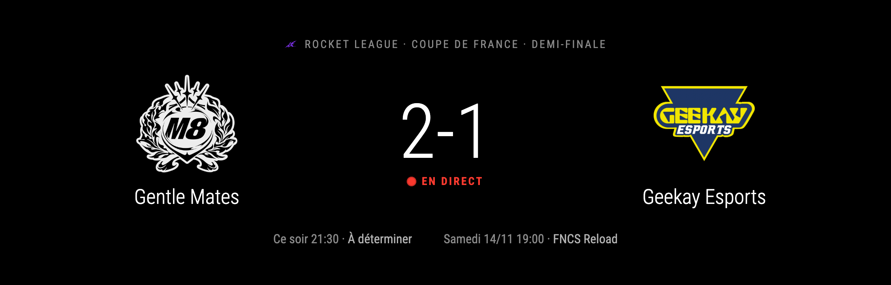
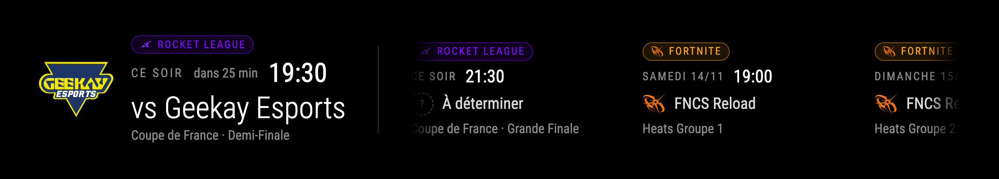
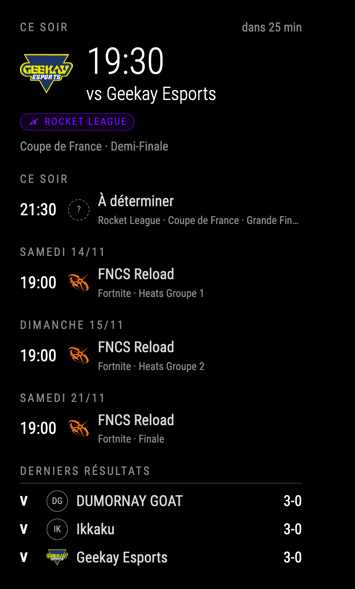
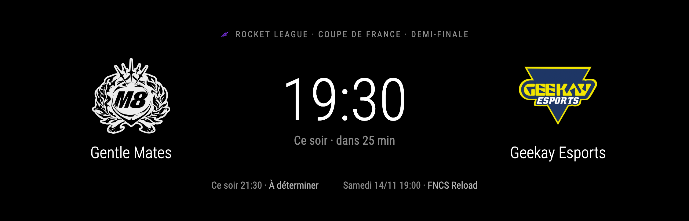
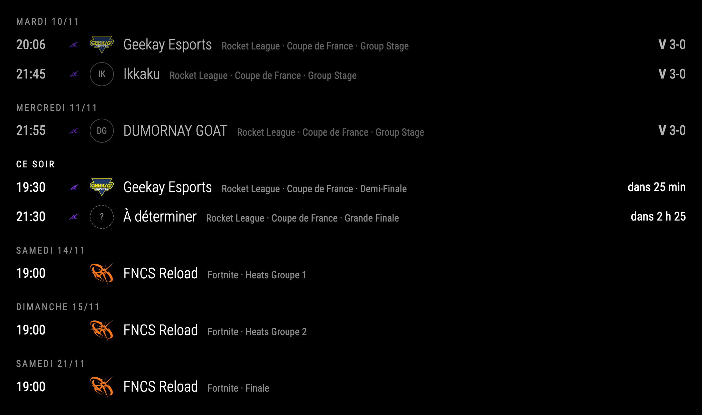

# MMM-GENTLEMATE-ESPORT

A [MagicMirror²](https://magicmirror.builders/) module for **Gentle Mates** esport matches: next match with countdown, live score, upcoming schedule and latest results, for Rocket League, Fortnite, Valorant and the other Gentle Mates rosters.

The layout adapts to where you put the module: a banner across the top, a column in a corner, or one big match in the middle of the mirror.



---

## Layouts

The default **modern** theme picks its layout from the module `position` (or force one with `layout`).

### Banner — `top_bar`, `bottom_bar`, `top_center`, `bottom_center`

The next match large on the left, the following ones beside it. They scroll slowly, right to left, only when they don't fit.



### Column — `top_left`, `top_right`, `bottom_left`, `bottom_right`



The next match with its countdown, then the upcoming matches grouped by day, then the latest results (W/L).

Opponents without a logo get their initials; tournaments without an opponent (FNCS…) show the event and the game pictogram; unknown opponents show "To be decided".

<br clear="right">

### Hero — `upper_third`, `middle_center`, `lower_third`, `fullscreen_*`

One match, big, with both logos, the countdown, and the two next matches underneath.



When a match is live, the score takes the centre with a pulsing red **LIVE** marker (screenshot at the top).

### List — `layout: "list"`

A full-width agenda grouped by day: past results with W/L and score, then the upcoming matches with their countdown.



### Classic theme — `theme: "classic"`

The original design, kept unchanged: a scrolling banner (`displayMode: "banner"`) or a static list (`displayMode: "list"`).


---

## Installation

```bash
cd ~/MagicMirror/modules
git clone https://github.com/FabienBounoir/MMM-GENTLEMATE-ESPORT.git
```

No npm dependencies, only Node.js built-ins.

## Configuration

```js
{
  module: "MMM-GENTLEMATE-ESPORT",
  position: "top_bar",
  config: {
    email: "your@email.com",
    password: "yourPassword",
    logoTheme: "white",
    gameNameStyle: "full",
    excludeGames: ["TFT", "AOE"]
  }
}
```

The email and password are those of your Gentle Mates account (the data comes from the Gentle Mates Supabase backend). The session token is cached and only renewed when it expires.

### Options

| Option | Default | Description |
|--------|---------|-------------|
| `email` | `""` | Gentle Mates account e-mail |
| `password` | `""` | Gentle Mates account password |
| `theme` | `"modern"` | `"modern"` or `"classic"` (the original design) |
| `layout` | `"auto"` | Modern only: `"auto"` (from the position), `"banner"`, `"column"`, `"hero"` or `"list"` |
| `coloredPictos` | `true` | Modern only: game tags and pictograms in the game colour (`false` = white) |
| `scrollSpeed` | `25` | Modern banner only: scroll speed in px/s when the matches don't fit |
| `displayMode` | `"banner"` | Classic only: `"banner"` (scrolling) or `"list"` (static) |
| `logoTheme` | `"dark"` | `"dark"` or `"white"` team logos (`"white"` suits a mirror) |
| `gameNameStyle` | `"short"` | `"short"` (RL) or `"full"` (Rocket League) |
| `excludeGames` | `[]` | Games to hide, by `short_name` (see below) |
| `hideUnknownTeams` | `false` | Hide matches whose opponent is not known yet |
| `numberOfFutureMatches` | `10` | Max upcoming matches |
| `numberOfPastMatches` | `3` | Max past results |
| `pastDays` | `10` | How many days back to fetch results |
| `use24HourTime` | `true` | `false` for AM/PM |
| `updateInterval` | `5` | Refresh interval, in minutes |

### Filtering games

`excludeGames` takes the games' `short_name` (case-insensitive):

| Game | `short_name` |
|------|-------------|
| Rocket League | `RL` |
| Fortnite | `FT` |
| Valorant | `VCT` |
| Valorant Game Changers | `VCT GC` |
| Call of Duty | `CoD` |
| Warzone | `WZ` |
| Teamfight Tactics | `TFT` |
| Age of Empires | `AOE` |
| Fighting Games | `FGC` |

---

## Features

- Layout chosen from the position: banner, column, hero or list; classic theme kept as an option
- Game shown on every match, as a pill in the game's colour
- Countdown ("in 25 min"), Tonight / Tomorrow / weekday labels
- Live score with a pulsing red marker
- Latest results with win/loss
- Smooth, slow scrolling only when the matches don't fit, without jumps on refresh
- English, French and Spanish

## Test

```bash
node test.js
```

## License

MIT — FabienBounoir
