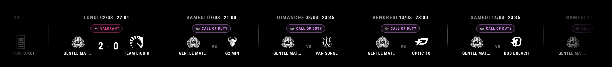
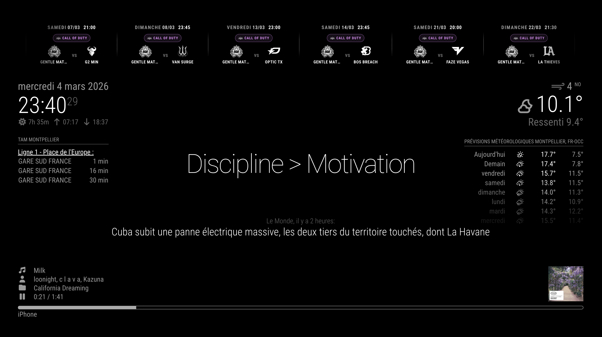

# MMM-GENTLEMATE-ESPORT

A [MagicMirror²](https://magicmirror.builders/) module that displays **Gentlemate esport** matches as a scrolling banner or a static list.

Data is fetched from the Gentlemate Supabase backend and refreshed automatically.

---

## Installation

```bash
cd ~/MagicMirror/modules
git clone https://github.com/FabienBounoir/MMM-GENTLEMATE-ESPORT.git
```

No external npm dependencies — only Node.js built-ins.

---

## Configuration

```js
{
  module: "MMM-GENTLEMATE-ESPORT",
  position: "bottom_bar",
  config: {
    email: "your@email.com",
    password: "yourPassword"
  }
}
```

## Screenshots



*Example of the scrolling banner showing upcoming matches.*



*Static list layout with dates, teams and scores.*


### All options

| Option | Default | Description |
|--------|---------|-------------|
| `email` | `""` | Supabase account e-mail |
| `password` | `""` | Supabase account password |
| `updateInterval` | `10` | Refresh interval in minutes |
| `numberOfFutureMatches` | `10` | Max upcoming matches to display |
| `numberOfPastMatches` | `3` | Max past matches to display |
| `pastDays` | `7` | How many days back to fetch past matches |
| `use24HourTime` | `true` | `false` for AM/PM format |
| `logoTheme` | `"dark"` | `"dark"` or `"white"` logo variant |
| `displayMode` | `"banner"` | Classic theme only: `"banner"` (horizontal scroll) or `"list"` (vertical static) |
| `excludeGames` | `[]` | List of game `short_name` values to hide (see below) |
| `theme` | `"modern"` | `"modern"` (new design, adapts to the position) or `"classic"` (the original banner/list design) |
| `layout` | `"auto"` | Modern theme only: `"auto"`, `"banner"`, `"column"`, `"hero"` or `"list"` |
| `coloredPictos` | `false` | Modern theme only: game pictograms in their brand colour instead of white |
| `scrollSpeed` | `40` | Modern banner only: scroll speed in px/s when the matches don't fit |

---

## Themes

**Modern** (default) picks its layout from the module position:

| Position | Layout |
|----------|--------|
| `top_bar`, `bottom_bar`, `top_center`, `bottom_center` | **Banner**: next match large, the following ones beside it, scrolling only when they don't fit |
| `top_left`, `top_right`, `bottom_left`, `bottom_right` | **Column**: next match, upcoming matches grouped by day, latest results (W/L) |
| `upper_third`, `middle_center`, `lower_third`, `fullscreen_*` | **Hero**: one match, large, with countdown or live score |

Force one with `layout`, or use `layout: "list"` for a full-width list grouped by day.
Only white and greys are used, so it reads well behind a two-way mirror. Tournaments without an opponent show the event name, unknown opponents show "To be decided".

**Classic** is the original design, unchanged:

```js
config: {
  theme: "classic",
  displayMode: "banner"   // or "list"
}
```

---

## Filtering games

Use `excludeGames` to hide matches for specific games. Pass an array of `short_name` values (case-insensitive).

```js
config: {
  excludeGames: ["TFT", "AOE"],  // hide Teamfight Tactics and Age of Empires
}
```

Available game identifiers:

| Game | `short_name` |
|------|-------------|
| Rocket League | `RL` |
| Fortnite | `Fortnite` |
| Valorant | `Valorant` |
| Counter-Strike 2 | `CS2` |
| Call of Duty | `CoD` |
| Warzone | `WZ` |
| Teamfight Tactics | `TFT` |
| Age of Empires | `AOE` |
| Fighting Games | `FGC` |

Leave `excludeGames` empty (default) to display all games.

---

## Features

- Modern theme adapting to the position (banner, column, hero, list), classic theme kept as an option
- Game badge per match (logo + short name, coloured with the game's brand colour)
- Live match indicator, countdown to the next match
- Win/loss score colouring
- Featured match highlight
- JWT token caching — re-authenticates only on expiry
- Tri-lingual: English, French, Spanish

---

## License

MIT — Author: FabienBounoir
